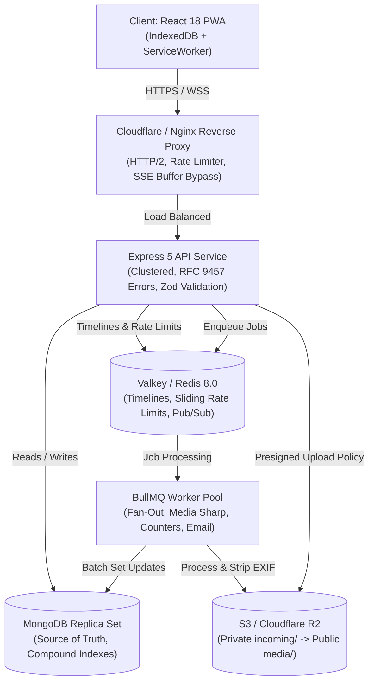

# Qelem (ቀለም)

[](https://github.com/PROFESSOR-ADNAN/qelem/actions/workflows/ci.yml)
[](LICENSE)
[](https://www.typescriptlang.org/)
[](https://valkey.io/)
[](https://www.mongodb.com/)
[](https://react.dev/)

> **ቀለም (Qelem)** — *"Ink"* in Amharic. A high-performance, resilient devlog and learning-in-public platform engineered for Ethiopian computer science students and junior developers on mobile networks.

---

## 🌟 Architectural & Engineering Highlights

Qelem is designed and built from first principles as a production-grade distributed system on a single VPS (< $25/mo budget) capable of handling 20,000 registered users, 1,500 concurrent connections, and 200 feed reads/second:

1. **Hybrid Fan-Out Timeline Engine (ADR-0004):**
   - Authors with $< 2,000$ followers fan out on write into their active followers' Valkey timeline sorted sets (`ZADD`).
   - High-fan-out authors ($\ge 2,000$ followers) are merged in at read time with a 1,600 follower hysteresis threshold to prevent flapping.
   - Verified against a mathematical reference model via property-based testing (`fast-check`).

2. **Tamper-Proof Keyset Pagination (ADR-0006):**
   - Opaque, HMAC-SHA256 signed cursors encoding `(createdAt, _id, filterHash, expiresAt)`.
   - Guaranteed **0 duplicates** and **0 skipped items** across page transitions during active concurrent writes. Zero `skip()` calls anywhere in the system.

3. **Hardened Media Ingestion Pipeline (ADR-0007):**
   - Direct-to-storage presigned uploads to an isolated private prefix (`incoming/`).
   - Worker validates magic bytes, enforces a 24-megapixel ceiling (`limitInputPixels: 24,000,000`), strips all EXIF and GPS coordinates, and generates optimized WebP variants and ThumbHash placeholders.
   - Fully hardened against SVG stored XSS, image decompression bombs, and file polyglots.

4. **Eventually Consistent Counters with Nightly Reconciliation (ADR-0008):**
   - Like and comment counters incremented atomically in Valkey via `HINCRBY`.
   - Flushed to MongoDB via absolute `$set` operations in 5-second batches. Nightly reconciliation workers compare counts against real document counts and log drifts to Prometheus.

5. **Race-Safe Notification Aggregation:**
   - Notifications aggregated ("Sara and 4 others liked your post") using a partial unique index on `(recipientId, groupKey)` where `readAt: null`.

6. **Offline-First PWA for Flaky Networks:**
   - Service Worker precaching (< 150 kB gzipped initial bundle).
   - Local timeline caching in IndexedDB via Dexie.js.
   - Outbox pattern: devlog drafts and queued posts sync automatically when connection recovers.
   - Bilingual interface: Full English and Amharic (አማርኛ) localization.

---

## 🏗️ System Architecture



---

## 📂 Repository Structure

```
.
├── docker/                     # Docker Compose configurations (dev & prod)
├── docs/                       # Architecture documentation
│   ├── adr/                    # 21 Architectural Decision Records
│   ├── runbooks/               # Incident runbooks (Redis down, counter drift, fanout lag)
│   ├── security/               # STRIDE threat model & OWASP ASVS v4.0.3 checklist
│   ├── openapi.yaml            # Complete OpenAPI 3.1 specification
│   └── vercel-deployment.md    # Vercel hosting instructions
├── nginx/                      # Production Nginx reverse proxy configuration
├── packages/
│   └── shared/                 # Shared types, Zod schemas, constants, and HMAC cursors
├── scripts/                    # Operational automation (backup, restore, smoke tests, deploy)
├── server/                     # Express 5 REST API & Server-Sent Events stream
├── tests/                      # Automated test suites
│   ├── unit/                   # Signed cursor verification tests
│   ├── property/               # Keyset pagination & feed reference-model property tests
│   └── media-attacks/          # Security attack test suite (XSS, polyglot, pixel bombs)
├── web/                        # React 18 PWA frontend (Vite, Tailwind, TanStack Query)
└── worker/                     # BullMQ background workers & repeatable cron schedulers
```

---

## 🚀 Quick Start (Local Development)

### Prerequisites
- Node.js >= 20.x
- Docker & Docker Compose
- Make

### 1. Clone & Set Up Environment
```bash
git clone https://github.com/PROFESSOR-ADNAN/qelem.git
cd qelem

# Copy environment template
cp .env.example .env
```

### 2. Start Supporting Infrastructure
```bash
# Spins up MongoDB replica set, Valkey, and LocalStack S3
make up
```

### 3. Install & Build Monorepo
```bash
npm install
npm run build
```

### 4. Seed Development Data
```bash
# Seeds cohorts, test accounts, follows, and initial devlogs
npm run seed
```

### 5. Run All Automated Test Suites
```bash
npx vitest run
```

---

## 🧪 Automated Testing & Security Verification

Qelem enforces rigorous automated testing across three tiers:

- **Unit Tests (`tests/unit/`):** Verifies HMAC-SHA256 cursor signing, tampering detection, timestamp expiration, and secret rotation.
- **Property-Based Tests (`tests/property/`):** Utilizes `fast-check` to mathematically prove that the hybrid fan-out feed output identically matches a brute-force reference model and guarantees 0 duplicate/skipped posts across arbitrary page chunks.
- **Media Pipeline Attack Suite (`tests/media-attacks/`):** Simulates real-world security vectors:
  - Stored XSS via malicious SVG files (rejected via binary magic-byte inspection).
  - WebP/HTML polyglot payload rejection.
  - Truncated/corrupted file handling.
  - 24MP decompression bomb defense.
  - Verification that GPS latitude/longitude and camera EXIF metadata are completely stripped.

---

## 🌐 Hosting on Vercel

The React PWA frontend can be deployed to Vercel in seconds while connecting to your backend API:

1. Import this repository into Vercel.
2. In **Project Settings**:
   - **Framework Preset:** `Vite`
   - **Root Directory:** `./`
   - **Build Command:** `npm run build --workspace=packages/shared && npm run build --workspace=web`
   - **Output Directory:** `web/dist`
3. Set Environment Variable: `API_BACKEND_HOST=api.yourdomain.com`.
4. Deploy! Full step-by-step instructions with custom domain setup are available in [docs/vercel-deployment.md](docs/vercel-deployment.md).

---

## 📜 Architectural Decision Records (ADRs)

| ADR | Title | Decision Summary |
|---|---|---|
| [ADR-0001](docs/adr/0001-vps-vs-kubernetes.md) | VPS vs Kubernetes | Single VPS with Docker Compose to stay under $25/month budget. |
| [ADR-0002](docs/adr/0002-valkey-vs-redis.md) | Valkey vs Redis | Adopted Valkey 8.0 under BSD-3-Clause to guarantee open-source longevity. |
| [ADR-0003](docs/adr/0003-argon2id-vs-bcrypt.md) | Argon2id vs Bcrypt | Argon2id with 64 MB memory cost to resist GPU cracking. |
| [ADR-0004](docs/adr/0004-hybrid-fan-out.md) | Hybrid Fan-Out Timeline | Write fan-out for < 2k followers, read merge for $\ge$ 2k followers with hysteresis. |
| [ADR-0006](docs/adr/0006-signed-keyset-pagination.md) | Signed Keyset Pagination | HMAC-SHA256 opaque cursors with 600-depth cap to eliminate `skip()` penalties. |
| [ADR-0007](docs/adr/0007-direct-to-s3-upload.md) | Direct-to-Storage Ingestion | Presigned upload policy with worker-isolated Sharp re-encoding to WebP. |
| [ADR-0008](docs/adr/0008-eventually-consistent-counters.md) | Eventually Consistent Counters | Valkey `HINCRBY` buffered to MongoDB every 5s with nightly exact reconciliation. |

---

## 📄 License & Compliance

Distributed under the **MIT License**.
Compliant with OWASP ASVS v4.0.3 Level 2. See [docs/security/asvs.md](docs/security/asvs.md).
