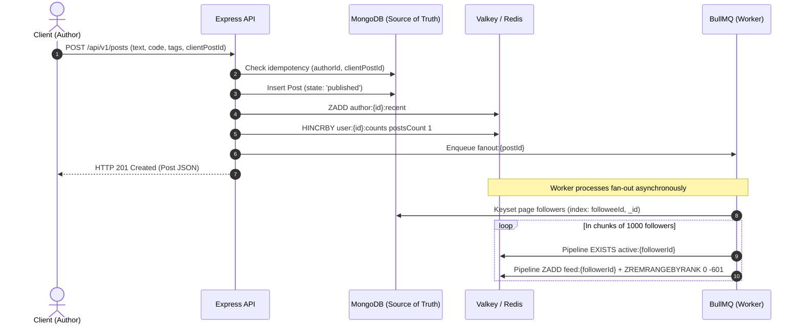
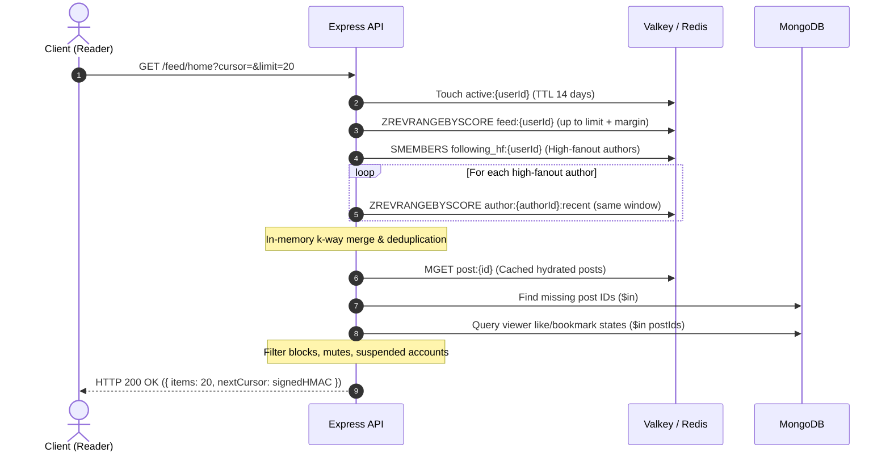

# Qelem Architecture Specification

## 1. System Overview & Component Topology

```mermaid
graph TD
    Client["Client Devices (Web PWA / Mobile)"] -->|HTTPS / WSS| CF["Cloudflare Edge (WAF, CDN, DDoS Guard)"]
    CF -->|Reverse Proxy :80/443| Nginx["Nginx Reverse Proxy"]
    
    subgraph "VPS Host Boundary (Docker Compose Network)"
        Nginx -->|Load Balance /api| API1["api (Replica 1) - Node/Express"]
        Nginx -->|Load Balance /api| API2["api (Replica 2) - Node/Express"]
        Nginx -->|/api/v1/stream| SSE["SSE Handler (proxy_buffering off)"]
        Nginx -->|Share Crawlers| ShareAPI["OG Preview Generator"]
        
        API1 -->|Queue Jobs| Redis["Valkey / Redis 8.0 (Timelines, Counters, Pub/Sub)"]
        API2 -->|Queue Jobs| Redis
        
        Worker["worker (BullMQ Processor Pool)"] <-->|Consume / Lock / State| Redis
        Scheduler["scheduler (Cron Dispatcher)"] -->|Enqueue Periodic Jobs| Redis
        
        API1 <-->|Read / Write| Mongo[("MongoDB 7.0 (Single-Node Replica Set rs0)")]
        API2 <-->|Read / Write| Mongo
        Worker <-->|State / Reconcile| Mongo
    end

    subgraph "External Cloud Services"
        Client -->|Direct Upload (Presigned)| Storage["Object Storage (Cloudflare R2 / S3)"]
        Worker -->|Process & Publish Variants| Storage
        Worker -->|Transactional / Digest| Email["Email Provider (Resend / Brevo)"]
        CF -->|Origin Fetch for media.| Storage
    end
```

## 2. Memory & Disk Budget (VPS Sizing Validation)

Target Host: **CX32 / CPX31 VPS (4 vCPU, 8 GB RAM, 80 GB NVMe SSD) @ ~$14/month**, comfortably inside the $25/month ceiling.

| Component | Target RAM | Max RAM Limit | Disk Footprint (Year 1) | Rationale |
|---|---|---|---|---|
| MongoDB 7.0 (rs0) | 1,500 MB | 2,000 MB | 25 GB | WiredTiger cache sized to 1.2 GB; indexes fit completely in RAM |
| Valkey / Redis 8.0 | 500 MB | 768 MB | 1 GB (RDB snapshots) | 20,000 users × 600 items timeline max + counter hashes |
| Node.js `api` (2 replicas)| 400 MB (200MB x2) | 800 MB | 500 MB | Stateless Express server with V8 `--max-old-space-size=256` |
| Node.js `worker` pool | 400 MB | 800 MB | 500 MB | Concurrency-limited BullMQ workers + Sharp image pipelines |
| Node.js `scheduler` | 100 MB | 150 MB | 100 MB | Lightweight repeatable job dispatcher |
| Nginx Reverse Proxy | 100 MB | 200 MB | 1 GB (Access & error logs with rotation) | Event-driven C binary with HTTP/2 and buffer pools |
| Monitoring (Prometheus + Alloy + Loki)| 600 MB | 900 MB | 15 GB (14-day metric & log retention) | Compact TSDB scrape intervals and compressed Loki chunks |
| Host OS & Buffer Cache | 1,000 MB | 1,500 MB | 15 GB | Ubuntu 24.04 LTS kernel, systemd, Docker daemon |
| **TOTAL** | **4,600 MB** | **7,118 MB (~86% of 8 GB)** | **58.1 GB (~72% of 80 GB)** | **Fits comfortably within 8 GB RAM and 80 GB SSD** |

### Redis Memory Detailed Calculation
- Active user timeline: 20,000 users × 30% active = 6,000 active timelines.
- Each timeline holds at most 600 post IDs (`ZSET`).
- Memory per ZSET entry: ~64 bytes (member string + score + hash table overhead) -> $600 \times 64 = 38.4 \text{ KB}$ per timeline.
- $6,000 \text{ active timelines} \times 38.4 \text{ KB} = 230.4 \text{ MB}$.
- Cached posts (`post:{id}`): 5,000 viral posts × 1 KB = 5 MB.
- Engagement hashes (`counts:{id}`): 20,000 posts × 100 bytes = 2 MB.
- BullMQ queue state & sets: ~50 MB.
- **Total Redis Footprint**: ~290 MB steady-state, well below the 768 MB hard cap.

---

## 3. Core Interaction Sequences

### 3.1 Publish Post Sequence


### 3.2 Home Feed Read Sequence (Hybrid Merge & Hydration)

