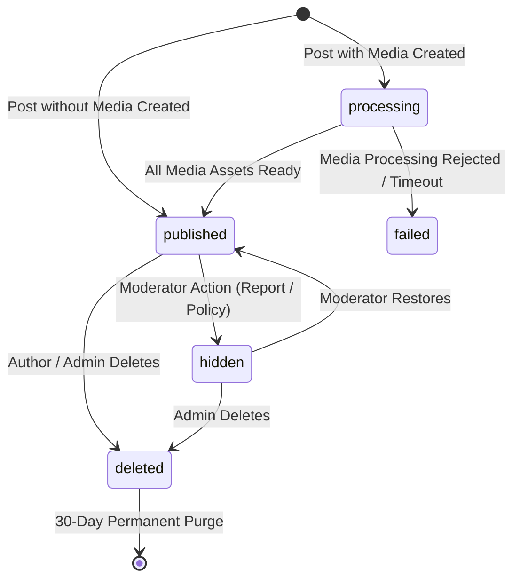

# Qelem Domain Architecture & Specification

## 1. Core Domain Models & Lifecycles

### 1.1 Post Lifecycle & State Machine
Posts transition through explicit, guarded states:
- `processing`: Initial state for posts with attached media. Invisible to everyone except the author. A background worker validates, resizes, and hashes media variants before triggering the publishing workflow.
- `published`: The post is active, indexed, fanned out to followers' timelines, and visible on public feeds, profile feeds, and tag pages.
- `failed`: Media validation or processing failed (e.g. decompression bomb, invalid format, timeout). The author is presented with an actionable error.
- `hidden`: Content quarantined by an administrator or moderator due to policy violations or community reports. Hidden immediately at read time via query/hydration filters.
- `deleted`: Soft-deleted by author or moderator. Invalidation job removes timeline entries; purge job removes database record and media files after 30 days.



### 1.2 Publishing Service Invariant
The publishing logic is encapsulated in a single idempotent service method `publishPost(postId)`:
1. Verifies that the post is currently in `processing` or direct transition to `published`.
2. Sets `state = 'published'` and `publishedAt = new Date()`.
3. Adds `postId` with score `publishedAtMs` to the author's recent post cache: `ZADD author:{authorId}:recent <score> <postId>`.
4. Increments author's `postsCount` in Redis and marks dirty for flush.
5. Updates tag usage stats in the `tags` collection.
6. Enqueues a single BullMQ job `fanout:{postId}` to the `fanout` queue.
7. Enqueues mention notification jobs for up to 5 resolved user mentions.

### 1.3 Media Pipeline (Direct-to-Storage with Hardened Processing)
1. **Presigned Upload Request**:
   - `POST /api/v1/media/upload-url` with `{ contentType, size, clientAssetId }`.
   - Validates MIME type allowlist (`image/jpeg`, `image/png`, `image/webp`) and size limit (<= 5 MB).
   - Generates presigned S3/R2 upload parameters targeted at `incoming/{userId}/{uuid}` expiring in 5 minutes.
   - Creates a `MediaAsset` document in state `pending`.
2. **Client Upload**:
   - Client PUTs raw binary directly to storage.
   - Client calls `POST /api/v1/media/:id/confirm`.
   - Server verifies S3 object existence and size, marks state `uploaded`, and enqueues job on the `media` queue.
3. **Hardened Worker Processing**:
   - Reads initial bytes and inspects magic numbers (rejects SVG, polyglots, animated formats).
   - Enforces Sharp `limitInputPixels(24_000_000)` to stop pixel bombs.
   - Decodes image with a 10s processing timeout.
   - Reads and applies EXIF orientation, then **strips all metadata** (EXIF, GPS, XMP, ICC).
   - Generates WebP variants:
     - `thumb`: 320 px longest edge
     - `medium`: 800 px longest edge
     - `large`: 1280 px longest edge (no upscale)
   - Generates ThumbHash / BlurHash placeholder string.
   - Computes SHA256 content hashes, uploads variants to `media/{hash}/{variant}.webp` with `Cache-Control: public, max-age=31536000, immutable`.
   - Deletes `incoming/` raw file.
   - Updates `MediaAsset` to state `ready`.
   - Checks if all media assets for the associated post are ready; if yes, calls `publishPost(postId)`.

---

## 2. Hybrid Fan-Out Architecture

### 2.1 Configuration Parameters
| Parameter | Value | Rationale |
|---|---|---|
| `FANOUT_MAX_FOLLOWERS` | 2,000 | Threshold above which write fan-out causes unacceptable latency |
| `FANOUT_HYSTERESIS_LOW`| 1,600 | Hysteresis lower band to stop state oscillation |
| `FEED_MAX_ENTRIES` | 600 | Redis ZSET depth limit per user timeline |
| `ACTIVE_WINDOW_DAYS` | 14 | Timeline fan-out skips users inactive > 14 days |
| `FANOUT_CHUNK` | 1,000 | Max followers processed per BullMQ job chunk |
| `HF_MERGE_WINDOW_DAYS`| 7 | Time window examined for high-fan-out authors |

### 2.2 Write Path
When `fanout:{postId}` is processed:
1. Check `author.fanoutMode`.
2. If `normal` (< 2,000 followers):
   - Query followers using keyset pagination on `Follow` index `(followeeId, _id)` in chunks of 1,000.
   - For each chunk, pipeline `EXISTS active:{followerId}` to filter out inactive users.
   - For active followers, pipeline:
     - `ZADD feed:{followerId} <publishedAtMs> <postId>`
     - `ZREMRANGEBYRANK feed:{followerId} 0 -601`
   - Store progress cursor so job failure resumes at the last processed chunk.
3. If `high_fanout` (>= 2,000 followers):
   - Post is already added to `author:{authorId}:recent`. No follower writes occur.

### 2.3 Read Path (`GET /feed/home`)
1. Touch `active:{userId}` with 14-day TTL.
2. If `feed:{userId}` is missing, trigger cold-start rebuild (with single-flight lock) or serve degraded path.
3. Fetch candidate posts from `feed:{userId}` using `ZREVRANGEBYSCORE` with cursor score.
4. Read `following_hf:{userId}` (set of followed high-fan-out authors, max 100).
5. For each high-fan-out author, read their newest posts from `author:{authorId}:recent` within the cursor score window.
6. Merge timeline entries and high-fan-out entries in memory, sort by `(score desc, postId desc)`, and deduplicate.
7. Hydrate posts, authors, and viewer engagement status in batched queries.
8. Filter out hidden/deleted posts, suspended authors, blocks, and mutes.
9. Refill up to 3 rounds if filtering drops count below requested limit.
10. Return items and signed HMAC cursor referencing the last examined entry.

---

## 3. Eventually Consistent Engagement & Counters

### 3.1 Live Redis Cache
- Likes and comments maintain live counts in Redis hash: `counts:{postId}` (`likeCount`, `commentCount`).
- Natural unique indexes in MongoDB (`(postId, userId)`) ensure idempotency.
- On valid mutation: `HINCRBY counts:{postId} <field> <delta>` and `SADD dirty:counts <postId>`.

### 3.2 Scheduled Absolute-Value Flush
- Every 5 seconds, worker pulls dirty post IDs.
- For each post, reads absolute count values from Redis.
- Performs bulk `$set` to MongoDB:
  ```typescript
  Post.bulkWrite(dirtyPosts.map(p => ({
    updateOne: {
      filter: { _id: p.id },
      update: { $set: { likeCount: p.likeCount, commentCount: p.commentCount } }
    }
  })));
  ```
- Retries are safe because `$set` is strictly idempotent.

### 3.3 Reconciliation Job
- Hourly reconciliation pulls all posts modified in the last 48 hours.
- Nightly reconciliation audits all posts with > 1,000 likes and a 1% random sample.
- Compares stored `likeCount` against `Like.countDocuments({ postId })`. Discrepancies are corrected and reported to Prometheus metric `counter_reconciliation_drift_total`.

---

## 4. Race-Safe Aggregated Notifications
- Notification group key: `type:targetType:targetId` (e.g. `like:post:123`).
- Collection Partial Unique Index: `{ userId: 1, groupKey: 1 }` with filter `{ readAt: null }`.
- When an action occurs:
  1. Worker tries atomic update:
     ```typescript
     await Notification.findOneAndUpdate(
       { userId: authorId, groupKey, readAt: null },
       {
         $addToSet: { actorIds: actorId },
         $inc: { actorCount: 1 },
         $set: { updatedAt: new Date(), seenAt: null }
       },
       { upsert: true }
     );
     ```
  2. If duplicate key race occurs during upsert, worker catches `E11000` and immediately re-executes update.
  3. Increments Redis unread counter `INCR unread:{userId}`.
  4. Publishes event to Redis channel `stream:user:{userId}` for instant SSE delivery.
